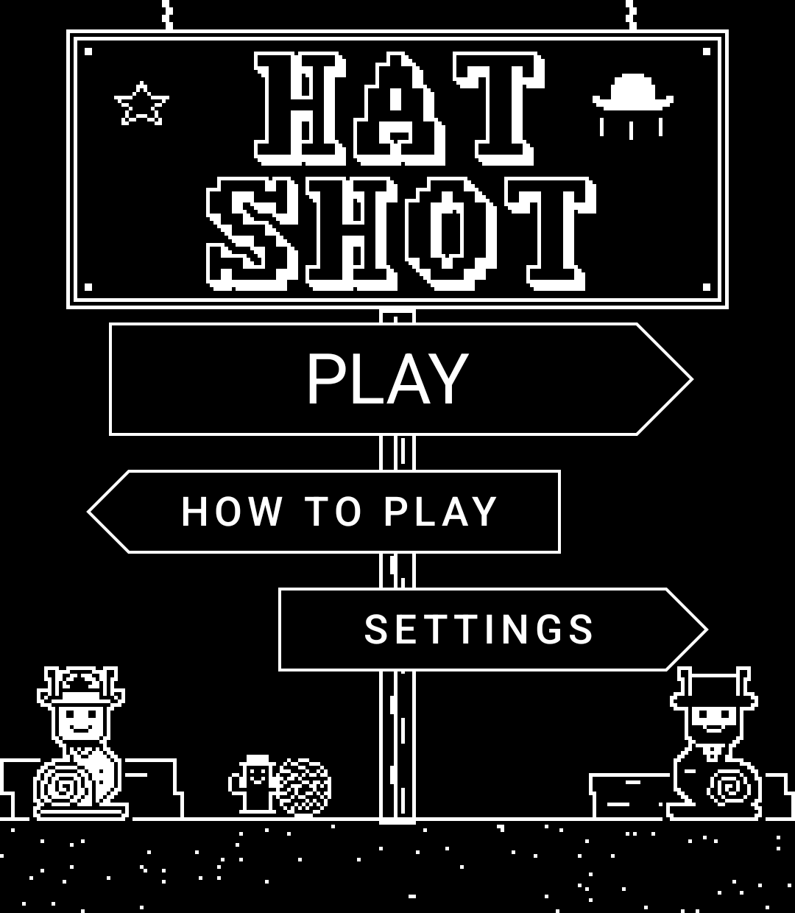
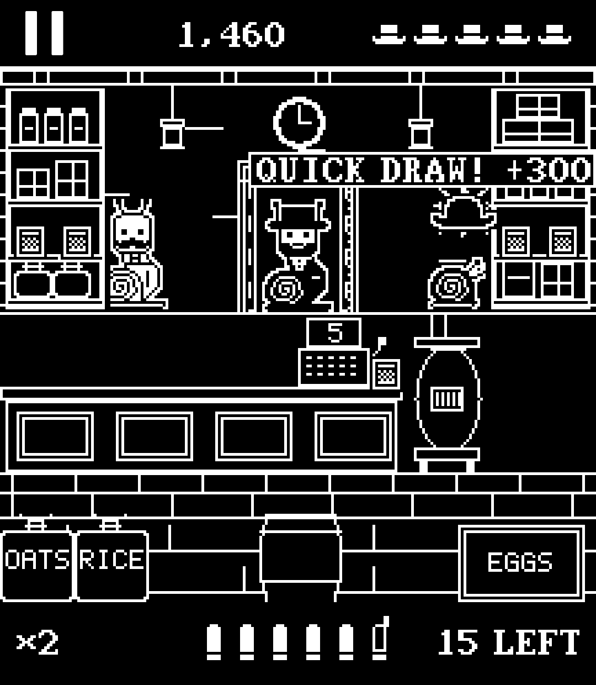
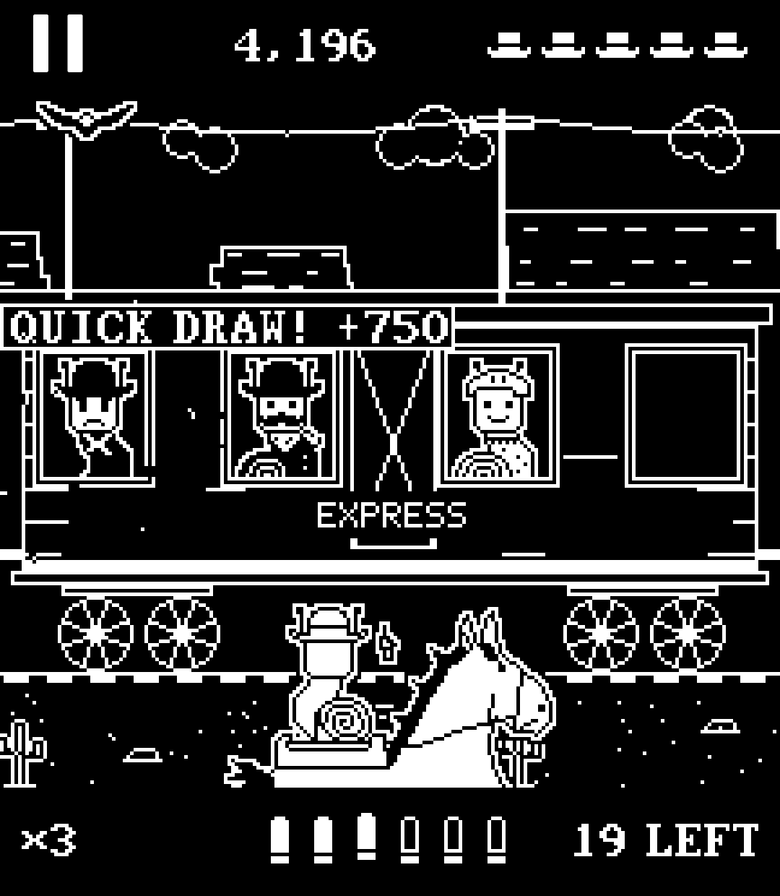
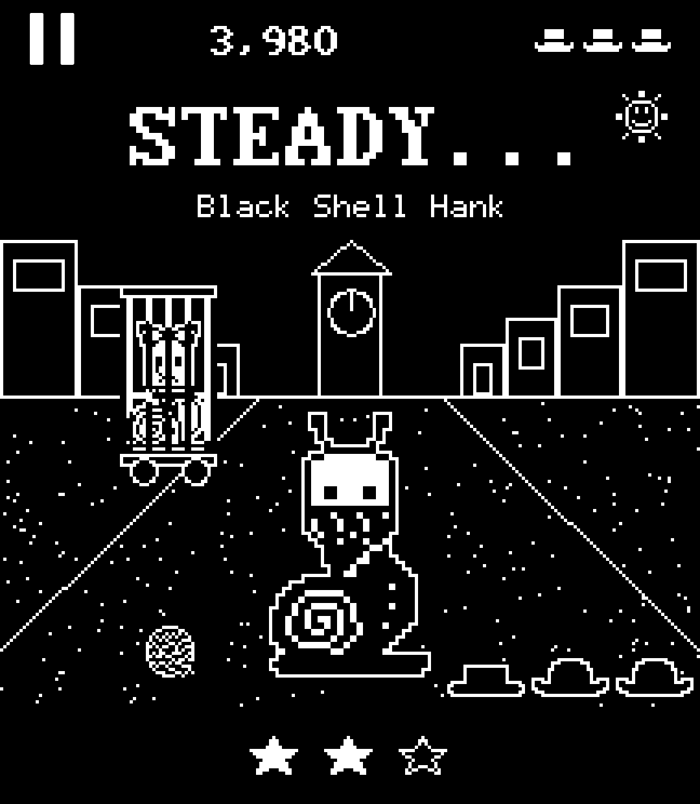

# Hatshot

A tap-to-shoot gallery for the Light Phone III, in 8-bit, and everyone in it is a snail. Made with love by Slow Pixels
especially for the Light Phone III, with the [Light SDK](https://github.com/lightphone/light-sdk): drawn in black and
white line work for its screen, and over when you put it down.

  
  
  
  

You're Mosey, the Slow Pixels mascot and Dry Gulch's new deputy. Black Shell Hank's gang has carried off Belle, and you
go after them: through the town, the General Store, the saloon, the bank, a canyon mine, a chase along a moving train
and the jailhouse, to a showdown at high noon. Shoot their hats off. Nothing gory: a snail whose hat is hit is inside
its shell before the hat comes down.

## Why a game belongs on a Light Phone

Hatshot was made for the Light Phone III from its first line, and it's built to Light's own guidelines:

- **Intentional.** It has a beginning and an end: eight stages of about a minute each, a story, and an ending. You
  pick it up on purpose, play a stage, and put it down. Nothing calls you back: no daily rewards, no streaks kept by
  the day, no lives that refill on a timer, no notifications. Stars and best scores are there to aim at when you
  choose to.
- **Private.** It asks for one permission, vibrate. No internet permission at all, so nothing can leave the phone: no
  accounts, analytics or tracking.
- **No advertising**, and nothing to buy.
- **Open source**, MIT licensed, here.
- **Built only with the Light SDK**: Light's top bar, lists, bottom bar, settings and type round the game, and the
  game drawn in black and white line work for the OLED, light page or dark.
- **Offline and long-lived.** No servers and nothing to download. The pictures, music and sounds are made in code,
  and the one tune it borrows, Scott Joplin's "The Entertainer" (1902), is in the public domain.
- **Gentle.** Nobody is hurt: shoot a snail's hat and it ducks into its shell. Targets only, in Settings, takes the
  people out for younger players.

## How it plays

- **Outlaws wear black**: black hat, black shell, black clothes (a neckerchief, a vest, crossed bullet belts). They look
  round, raise a six-shooter (a "!" shows beside
  the head), and fire. Shoot first. Hit the hat and it flies off while its owner ducks inside. Hit the shell, the harder
  shot, and it goes off in pieces ("MY SHELL!") and scores double.
- **Good folks wear white**: the sheriff, granny, a kid, the barkeep, a baby snail. Hitting one costs a hat and
  points. Every snail is drawn black ink on white and cut out with a thin white edge, so a black hat
  shows on the black page and the rule reads the same on the light one.
- **Belle** is who you came for. She shows up at the train's windows and waves from her cell at the jailhouse. Hit her
  and the stage is over there and then.
- **Balloons, bottles, cans and bullseyes** are for points. A bullseye's middle scores triple; all the bottles earn a
  bonus; a star balloon gives back a hat.
- **Six bullets**, then tap the bar at the foot of the screen, or press the camera button, to reload. Hits in a row
  build a multiplier up to ×4; a miss ends it.
- **Five hats** a stage. One to three stars at the end: Deputy, Sheriff, Marshal. The results page says what the next
  star needs, and the card before a stage shows your best there.
- **The stages have their own tricks, and things to break.** In the General Store the sacks of oats and rice and the
  crate of eggs spill, the clock comes off the wall and the goods off the shelves, all for a few points, and the till
  rings up a new number every time, for none; in the Rusty Spur the piano player plays "The Entertainer" (hit him and
  the music stops), and the mirror, the glasses, the keg and the spittoon can all be shot; in the bank the money bags
  burst and are back a few seconds later, and the sign breaks in two; in Buzzard Canyon a crate of TNT takes out the
  outlaw hiding behind it, and the mine cart rolls out of the tunnel with an outlaw riding in it; on the train you're riding alongside,
  and you can see Mosey fire; at the jailhouse the water trough and the barrels can be stove in, and the sign on the roof shot in two.
- **High Noon** is three quick-draws against the gang's leaders, Black Shell Hank last, who takes three shots: his hat,
  his bandana, then the shell he's named for. Wait for DRAW!, then tap, or press the camera button. Tapping early is a foul, and so is firing at one of the
  words they slam in to fool you (DRAG!, DRAT!...); only the real DRAW makes an outlaw raise his gun.

A page or two of story comes before each stage, and the ending follows High Noon. **Targets only**, in Settings, is for
younger players: bullseyes come out in place of snails, nobody shoots back, and High Noon's duels are against a target.
(Someone who's always there, the piano player or Belle in her cell, is there in Targets only too and still mustn't be
hit; the card before the stage says so.)
**Pace** (Calm, Normal, Quick) sets how long targets stay out.

## Made to move

The Light Phone III's screen can show movement, so:

- Shutters swing, blinds roll and the vault door turns open; snails slide out and duck back in.
- A hat shot off hangs for a moment, as in a cartoon, then goes up turning over and falls away, past the score if it has
  to. A shell goes off in pieces that arc and drop. Bottles shatter, cans hop off the shelf, balloons pop in a ring,
  and each shot throws a spent case up out of the bottom bar.
- When you're hit the street shakes, its edge flashes, and one of your hats leaves the top bar.
- Beside the train, the mesas, the telegraph poles and the ground go by at their own speeds, the far ones slowest, and
  each new car slides alongside.
- At High Noon the word lands with a thump, a beaten leader's hat comes down in the street and stays there, and a
  tumbleweed goes by while everyone waits.

It all stays 8-bit: everything is drawn on a 216 × 248 grid (five screen pixels to a game pixel), moves a whole game
pixel at a time and turns a quarter turn at a time, and is blown up to the screen with no smoothing.

## How it fits LightOS

- **Black and white only, and mostly black.** The town is thin line work in the page's ink with nothing filled in, one
  weight of line, and no more of it than the eye needs (boards and stonework are only hinted at). The snails are the
  only solid things in the picture: Light's hollow shapes that fill in when they matter. The light page (Settings ›
  Page) is the same drawing, black on white. LightOS's own theme follows.
- **Pixel letters in play.** The score, your hats, the bullets and what's left to shoot are drawn in the game's own
  letters, in the picture; menus, settings and the cards round a stage are Light's own type.
- **Light's kit around the game.** The top bar (pause, the score), the stage list (the next stage underlined, as
  LightOS marks a choice; stars for stages won), the card before a stage, the results page and its bottom bar (Replay,
  NEXT, Stages: one word between two icons), Settings and How to play are `LightTopBar`, `LightBottomBar`, `LightText`
  and Light's icons. The bullets are hollow shapes that fill when loaded.
- **The screen is held on only while a stage is being played**, between the start and the results. Leaving the tool
  pauses the game.
- **Music pauses a podcast.** A tool can't ask Android for audio focus, so `audio/Holder.kt` keeps one of Light's
  players playing silence while a stage's music plays: other sound on the phone pauses rather than playing over it, and
  a call pauses the game. With Music off in Settings nothing is taken.
- **The camera button and the wheel's press** reload, and fire at High Noon. Volume stays with LightOS.
- **Buzz**: a short one on a hit that costs you, a longer one when you're shot. It can be turned off.
- Nothing leaves the phone: no internet permission, no accounts. Scores and settings are a small file in the tool's
  own folder. The only permission is to vibrate.

## How it's made

- `game/` has no Android in it, so tests can play it and draw it. `Round.kt` is one go at a stage (the rules, with
  everything moving on time), `Duel.kt` the quick-draw, `Western.kt` the eight stages laid out for
  this screen, `WesternArt.kt` the snails and props as text pictures, `WesternScenes.kt` the backgrounds and doors,
  `Train.kt` the chase, `Story.kt` the story pages, `Synth.kt` and `Music.kt` the sounds and songs, all synthesised.
  `Juice.kt` is everything that flies. `Frame.kt` is the picture: one array of 216 × 248 colours, drawn from scratch
  every frame.
- `ui/` is the screens. `GameScreen.kt` is a stage from its story to its results; `Pixels.kt` blows a frame up to the
  screen and turns touches into game pixels.
- `./gradlew :tool:testDebugUnitTest` runs 30 tests: bots play every stage at every pace (winnable, about a minute,
  everything on screen and big enough to tap), the rules, and what flies. `HammerTest` is 84 games and 40 duels played
  by a thumb with no sense at all (taps anywhere, any time, frames of every length), drawn every frame, on both pages:
  nothing may throw and the numbers must stay possible. `ShotsTest` draws every stage, story page, train car and the
  duel into `tool/build/shots`.
- `scripts/` plays the game on the simulator from outside. `sight.py` and `duel_sight.py` look at real screenshots,
  find outlaws' hats (or the word DRAW!) and tap them through the touch screen: 20 hats seen, 20 tapped, 20 of 20 hit.
  `soak.sh` wins all eight stages back to back with a debug build's own player, watching for crashes and memory.

All the pictures, music and sounds are original to this game, except the Rusty Spur's tune: Scott Joplin's "The
Entertainer" (1902, in the public domain), arranged here for the sound chip from the Mutopia Project's edition. Made
with love by David Altizer. Luke 11:9.
Slow Pixels, 2026.

The game is MIT licensed (`LICENSE-HATSHOT`); the Light SDK around it keeps its own licence (`LICENSE`).
